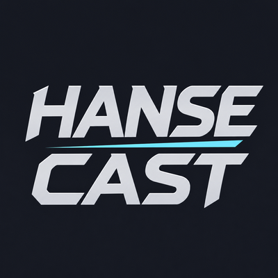

# Hanse Cast

Animated cast bars for **WoW Forever 1.60.1**. Current version: **0.9.1 beta**.

## Features

- Player casts and channels with spell name, progress and configurable time display.
- Separate global cooldown indicator.
- 145 visual variants, selectable independently of character class or faction.
- Optional target and focus cast bars.
- Named profiles with validated text import/export.
- German and English interface. No additional addon or runtime library required.

## Installation

Copy the `HanseCast` folder into your game's `Interface/AddOns` directory and fully
restart WoW. The resulting path must end in `Interface/AddOns/HanseCast/HanseCast.toc`.
When using GitHub's Download ZIP, extract it first and copy only the inner
`HanseCast` addon folder, not the complete repository folder.

Type `/hansecast` for settings, `/hansecast test` for preview, and
`/hansecast status` for diagnostics. Target/focus bars are disabled by default.

## Documentation

- [English description](docs/public/DESCRIPTION-EN.md)
- [Deutsche Beschreibung](docs/public/DESCRIPTION-DE.md)
- [English menu guide](docs/public/MENU-EN.md)
- [Deutsche Menüanleitung](docs/public/MENU-DE.md)
- [Changelog](CHANGELOG.md)
- [Credits and resource notice](docs/public/CREDITS.txt)

## Beta status

This package targets WoW Forever 1.60.1 / interface 16001. Other editions are not
currently supported. Initial live gameplay, frame-time comparisons and persistence
of the tested settings after reload/restart have been checked. Wider functional,
class/style and target/focus coverage remains part of beta testing.

Restricted or unavailable cast data can hide the affected custom bar. Fully
restricted duration objects and empower casts are not supported. Channel guide
lines are manual markers rather than detected ticks. Performance on every system
is not guaranteed.

## License

Free personal use under [All Rights Reserved](LICENSE.txt). Public source visibility
does not grant an open-source license or unrestricted redistribution rights.
Custom artwork and the logo were prepared with AI assistance. Blizzard and other
third-party resources remain the property of their respective owners.

## Deutsch

Hanse Cast ist ein eigenständiges Zauberleisten-Addon für WoW Forever 1.60.1.
Den inneren Ordner `HanseCast` nach `Interface/AddOns` kopieren und WoW vollständig
neu starten. Mit `/hansecast` die Einstellungen öffnen. Die deutsche Anleitung
und Menüerklärung sind oben verlinkt. Version 0.9.1 ist eine Beta; die Lizenz bleibt
All Rights Reserved bei kostenloser persönlicher Nutzung.
